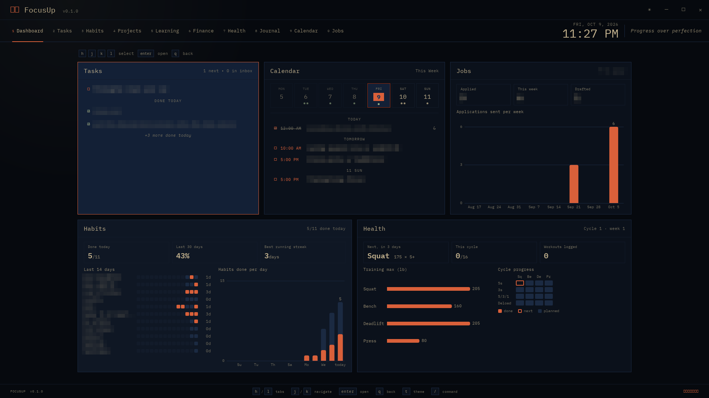

# focusup
a personal desktop GUI application to stay focused and organized.

## Wanna try the application on your device?
`git clone https://github.com/mikevidotto/focusup`

`cd focusup`

`wails dev`

## Workouts on your phone (gym server)
The 5/3/1 program can live on an always-on machine (e.g. a Raspberry Pi) so you can see
the day's weights and log your AMRAP reps from your phone at the gym. The desktop app
then reads and writes that same copy.

Step-by-step setup (building, the Pi service, Tailscale, the iPhone and FocusUp): see
[docs/gym-server-setup.md](docs/gym-server-setup.md).
